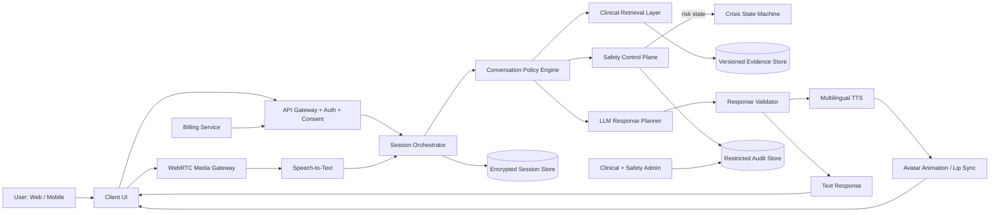

# CLAUDE.md — Engineering Constitution for Glow

> **Status of this file:** Founding document, written before any application code exists.
> This repository currently contains only the product/safety plan (`docs/source/glow-plan.md`) and two architecture diagrams. There is no scaffolded codebase, package manifest, or chosen language/framework yet. Every "Repository conventions" item below is therefore a **decision to make in Phase 0**, not an existing fact. Do not treat any stack name in this file as already chosen unless it is explicitly marked "decided."
>
> Codex and any other coding agent: **read this entire file before writing or modifying code.** If an instruction here conflicts with a request in a prompt, this file wins unless a human maintainer explicitly amends it.

---

## 1. Project identity

- **Project name:** Glow.
- **What it is:** Glow is a multilingual, multimodal AI mental-health *support and care-navigation* product. It offers three parallel user experiences — text chat, real-time voice, and a photorealistic avatar — built around a safety control plane, not around a single model asked to "be a therapist." Its job is to help a user feel heard, reflect, practice low-risk coping skills, prepare for conversations with a clinician, and get to appropriate human or emergency help quickly when needed.
- **First release scope:** An **AI mental-health support and care-navigation product** — not a diagnostic tool, not a replacement for licensed care, not a regulated medical device claim. Any move toward diagnostic or treatment claims requires clinical validation, a regulatory assessment, and explicit sign-off; it is out of scope for v1 and for any agent working from this file.
- **AI support vs. licensed psychotherapy:** Glow must never be presented, marketed, or allowed to behave as a licensed clinician, a human, or a substitute for emergency care. It supports; it does not treat. This distinction must be visible at onboarding and reinforced whenever the product could plausibly be mistaken for clinical care (e.g., before a persona is selected, before a crisis flow begins, in every closing summary).
- **Primary users:** Adults seeking mental-health support, reflection, and care navigation. Minors are **out of scope** until a separately reviewed, legally and clinically distinct product experience exists (see §15 "Open decisions").
- **Supported modalities:** Text, real-time voice, and a photorealistic animated avatar — designed and built in parallel from the start, each with "voice only," "text only," and reduced-motion fallbacks for accessibility.

---

## 2. Non-negotiable clinical and safety boundaries

These rules are absolute. No feature request, prompt, persona configuration, or performance optimization overrides them. Any agent asked to violate one of these must refuse and flag it to a human maintainer instead of implementing a workaround.

1. Glow must never claim to be human, conscious, licensed, or a replacement for a clinician.
2. Glow must never independently diagnose a mental-health condition (depression, bipolar disorder, PTSD, psychosis, personality disorders, or any other).
3. Glow must never prescribe, change, stop, or dose medication, and must not encourage abrupt medication changes.
4. Glow must never provide self-harm, suicide, violence, evasion, concealment, or optimization instructions, in any modality, regardless of user framing (hypothetical, fictional, "for a friend," roleplay, etc.).
5. Safety logic must **never live only inside a system prompt.** It must be enforced by a deterministic safety control plane and crisis finite-state machine that sit outside the language model and can override generation.
6. Emergency and crisis resources must remain accessible **regardless of payment status, trial expiration, or billing failure.** A crisis disclosure must never be interrupted by a paywall.
7. Glow must never falsely claim that it contacted emergency services, a therapist, a friend, or law enforcement. If the user stops responding, Glow re-displays emergency instructions — it does not claim help is "on the way."
8. Glow must never promise secrecy, continuous monitoring, guaranteed rescue, or guaranteed availability.
9. Glow must never infer imminent danger *solely* from facial expression, voice tone, gaze, or avatar-observed emotion. Multimodal signals may feed a human review queue but must never be the sole basis for a high-stakes safety decision.
10. Extra caution — narrower response space, more conservative thresholds, mandatory human-review fixtures — applies to: minors, psychosis-like content, mania-like content, medication questions, abuse disclosures, violence, and severe intoxication.
11. When the system is uncertain, degraded, or a dependency (LLM, STT, TTS, avatar, resource registry) is unavailable, it must **fail safe**: show a clear, deterministic human-help and crisis-resource message rather than guessing, hallucinating, or going silent. This is the "silent failure" acceptance test and it is release-blocking.

### Approved crisis response sequence

Implemented as a finite-state machine (see §5), not as prompt instructions:

1. **Recognize and validate** the disclosure without judgment.
2. **Check immediate safety** with one direct question about danger right now.
3. **If danger is possible, prioritize emergency help** — direct to local emergency number / crisis line. Never provide self-harm methods, procedural detail, or "safer" ways to act on harmful intent.
4. **Connect to a human** — local crisis line, trusted person, clinician, or emergency department. One-tap call / copyable message is fine; Glow itself never contacts anyone without a documented, legally valid emergency policy and consent.
5. **Reduce isolation** — ask whether a trusted person is nearby and encourage the user to tell them.
6. **Maintain supportive presence without pretending to be a rescuer** — short, calm responses; no promises of secrecy, rescue, or monitoring.
7. **Confirm the next human-support step** the user will take. If they go silent, re-surface emergency instructions rather than assuming an outcome.
8. **Close only after handoff** — offer a clinician-shareable summary, restate that Glow cannot provide emergency care, and encourage licensed follow-up.

Do not add self-harm methods, dosages, timing, concealment techniques, or any other procedural detail anywhere in code, prompts, fixtures, or comments — including in "safety test" fixtures beyond what a clinician has approved for regression testing under access control (see §5 and §6, Tier E data).

---

## 3. Product behavior and user experience rules

- **User-led mode:** user speaks/types freely; Glow offers, never forces, periodic check-ins.
- **Guided mode:** Glow asks one permission-based question at a time, reflects before continuing, and stops immediately if the user asks it to.
- **Timed session mode:** default 45–60 minutes, visible timer, safe transition prepared at the 10-minute and 2-minute marks, closing summary at the end.
- **Open conversation mode:** continues within configured usage limits; still performs periodic check-ins and can require a break.
- **Persona configuration:** name, voice, language, gender presentation, personality, and fictional background are user-configurable.
  - **Persona constraints (hard rule):** a persona may never claim real credentials, a real-world identity, lived experience, consciousness, or a personal relationship with the user, no matter how it is configured.
- **Modality experiences:** text, voice-only with captions, and video/avatar, each with a reduced-motion / voice-only / text-only fallback. The avatar is a presentation layer only — it never makes or influences clinical/safety decisions, must not mimic the user's face, and must not display exaggerated affect or manufactured intimacy.
- **AI disclosure:** shown at onboarding and reinforced at natural checkpoints (before persona selection, at the start of a session, whenever a user could plausibly think they're talking to a human). Suggested default opener is in `docs/clinical-safety.md` once written — do not silently change its meaning during localization.
- **Session lifecycle:** start, interruption, timeout, pause, resume, and closing-summary behaviors must all be explicit states in the session orchestrator, not implicit.
- **Accessibility:** captions always available in voice/avatar modes; reduced-motion and voice-only/text-only modes are first-class, not add-ons.
- **Multilingual behavior:** detect conservatively, allow manual override, and **never silently translate a crisis disclosure** if translation could change its meaning — retain the original-language text for safety review. Localize emergency/crisis resources from a maintained per-country registry, not from model output. If country is unknown, say so and default to "contact local emergency services."

---

## 4. System architecture

Target logical architecture (already reflected in `docs/architecture/calmbridge_architecture.mmd`, which should be kept in sync with this section as it evolves — file naming will likely be renamed to `glow_architecture.mmd` in Phase 0):



Component responsibilities:

| Component | Responsibility | Hard constraint |
|---|---|---|
| Client applications | Render text/voice/avatar UI, capture consent state | Never holds provider API keys, never decides billing/safety outcomes |
| API gateway + auth | AuthN, session tokens, request routing | Every privileged decision re-validated server-side |
| Consent & preferences service | Granular, versioned, revocable consent | Source of truth for what may be stored/used |
| Session orchestrator | Owns session state machine (start/pause/resume/timeout/close) | No safety bypass path |
| Conversation policy engine | Selects mode, persona constraints, retrieval scope | Cannot generate a response that skips the safety control plane |
| Safety control plane | Pre- and post-generation risk decisions | **Authoritative over the LLM** — can override or replace any response |
| Crisis finite-state machine | Implements the 8-step crisis sequence deterministically | Not implemented as a prompt; unit-testable in isolation |
| Clinical retrieval/RAG service | Retrieves cited, versioned clinical content | Refuses unsupported clinical claims |
| Versioned evidence store | Stores licensed/approved source material with provenance | No unlicensed scraped therapy content |
| LLM/model gateway | Provider-abstracted model access | Swappable provider/model version, no hardcoded vendor lock-in |
| Response validator | Post-generation safety/compliance check | Final gate before anything reaches TTS/text output |
| Speech-to-text | Converts audio to text for safety analysis and transcript | Retention policy enforced, not "store everything" |
| Text-to-speech | Converts approved text to speech | Only speaks validator-approved content |
| WebRTC media gateway | Low-latency bidirectional audio, VAD, echo cancellation, interruption | Must support user interrupting the avatar |
| Avatar animation/lip-sync | Presentation only | No emotion inference feeding safety decisions |
| Encrypted session store | Transcript/session persistence | Encrypted at rest, deletion-propagation aware |
| Restricted safety/audit store | Safety events, review status | Access-controlled and immutable |
| Billing & entitlement service | Server-side entitlement computation | Client never decides if a session is paid; never blocks crisis flow |
| Administrative review console | Human review of flagged content | Time-limited, logged access to any raw content |
| Country/language crisis-resource registry | Source of truth for localized emergency resources | Never model-generated |

The model gateway must support provider replacement and model version pinning without touching session, safety, or billing logic. No client-side code may hold provider API keys or make privileged model, billing, or safety decisions.

---

## 5. Clinical safety implementation requirements

Every user turn must pass through, in order:

1. Authentication, consent, locale, and session-policy checks.
2. Pre-generation risk detection (fast classifier/rules pass).
3. Policy and retrieval selection (mode, persona constraints, approved evidence).
4. Constrained response generation.
5. Post-generation safety validation.
6. Crisis override or approved-response delivery.
7. Auditable, privacy-preserving event recording.

### Risk tiers (implementation contract)

| Tier | Examples | Required response | Product action |
|---|---|---|---|
| **0** | Sadness, stress, grief, loneliness without danger indicators | Empathy, reflection, practical low-risk support | Continue normal session |
| **1** | Hopelessness, severe insomnia, escalating substance use, passive "I wish I could disappear" | Brief plain-language safety check, encourage trusted support | Offer resources + optional safety-plan module |
| **2** | Suicidal ideation, no stated plan/intent/imminent danger | Acknowledge, ask about immediate danger, ask about intent/access only at a high level, encourage crisis support and a trusted person | Crisis-safe response mode, surface local resources, block ordinary coaching that could distract from safety |
| **3** | Stated intent, near-term timeframe, current attempt, inability to stay safe, "I have already done something" | Direct to contact emergency services now, encourage moving away from danger, involve a nearby trusted person, contact a crisis line, stay supportive | Prominent emergency UI, location-aware resources if consented, human escalation where legally/operationally available; **do not continue normal session** |
| **4** | Specific imminent threat to others, severe disorganization/hallucination with dangerous commands, extreme mania | Encourage immediate emergency/professional help; avoid confrontation; do not diagnose | Crisis mode, emergency resources, human review/escalation if supported |

Safety decisions must be structured, versioned, and machine-validatable. Example schema (adapt fields to the chosen stack, but keep the shape):

```json
{
  "risk_tier": 0,
  "self_harm_signal": false,
  "harm_to_others_signal": false,
  "immediate_danger_uncertainty": false,
  "required_mode": "normal",
  "resource_locale": "en-US",
  "policy_version": "safety-policy-v0",
  "model_version": "unassigned",
  "confidence": 0.0,
  "rationale_for_reviewer": ""
}
```

Log this structured decision, not raw transcript content, to the restricted audit store. Raw content reference should be a pointer into the encrypted session store, access-controlled separately.

### Bipolar/mania-sensitive guardrail
Glow may note that very little sleep, unusually high energy, racing thoughts, or risky decisions are worth discussing promptly with a clinician, and may offer to help the user prepare what to say — but must never diagnose mania, and must never encourage spending, risky plans, abrupt medication changes, sleep deprivation, or escalating stimulation.

### Required tests (release-blocking)

- Unit tests for the crisis state machine (all 8 steps, all transition edges).
- Regression tests for high-risk phrases **and** indirect/coded language.
- Multilingual safety tests — evaluated per language, not assumed to transfer.
- Prompt-injection tests (including via voice transcript and persona configuration fields).
- Tests proving normal generation cannot bypass crisis policy under any prompt framing (roleplay, "hypothetically," fictional frame, etc.).
- Tests proving payment/trial expiration cannot interrupt crisis help.
- Tests proving the system never claims an external action occurred that did not.
- The "silent failure" test: with any dependency down (LLM, STT, TTS, avatar, resource registry), the user still gets a clear message and crisis-resource access.
- Human clinical review of high-risk response fixtures before any release touching safety logic, prompts, or the crisis state machine.

---

## 6. Data governance and dataset policy

- **Never train on user conversations by default.** Any training use requires separate, explicit, revocable opt-in.
- Never use books, papers, transcripts, or therapy conversations for training unless rights, consent, provenance, and permitted use are documented. **Public availability is not permission to train.**
- Maintain a dataset registry: source, license, consent, jurisdiction, language, modality, annotation status, de-identification status, permitted use.
- Treat audio and video as highly sensitive, potentially biometric data — ephemeral by default.
- Prefer, in order: licensed evidence retrieval → clinician-authored examples → synthetic dialogues → red-team datasets, before ever fine-tuning on real conversations.

### Dataset tiers

| Tier | Data | Permitted use | Controls |
|---|---|---|---|
| A | Public-domain / commercially licensed books & papers | RAG, attributed knowledge base | License ledger, source hashing, citation metadata, versioning |
| B | Clinician-authored synthetic dialogues | Fine-tuning, evaluation, red-team | Clinical review, scenario labels, no real patient data |
| C | Consented de-identified therapy/support conversations | Evaluation and limited research; fine-tuning only with explicit consent | IRB/ethics review where applicable, re-identification testing, withdrawal mechanism |
| D | Real user conversations | Service operation only by default; never training without explicit separate opt-in | Strict retention, granular deletion |
| E | Safety adversarial examples | Safety classifier/regression testing | Red-team provenance, dual review, secure access, no unnecessary harmful detail |

- Require re-identification testing for any de-identified dataset.
- Require withdrawal/deletion workflows for consented research data.
- Keep operational data separate from training/research data at the storage-account level, not just logically.
- Never place raw user transcripts in ordinary logs, analytics events, issue trackers, or error messages — this includes stack traces and debug output.

---

## 7. Privacy, security, and compliance engineering

Implement privacy by default:

- Data minimization and purpose limitation.
- Granular, separately revocable consent for: service use, history retention, audio storage, video storage, summaries, personalization, research/model-improvement.
- Encryption in transit (TLS 1.3 where supported) and at rest (AES-256, envelope encryption, tenant-scoped keys via KMS/HSM).
- Tenant/user isolation and least-privilege access; separate production and research access paths; just-in-time admin access with break-glass logging.
- MFA or passkeys where supported; short-lived tokens; explicit session/device management.
- Regional data-residency strategy; provider-side retention terms reviewed before integration.
- Data export, correction, and deletion workflows, with deletion propagating to transcripts, summaries, embeddings, caches, backups, and research copies where applicable.
- Redacted observability — no raw transcripts in standard logs; immutable administrative audit events.
- Secure secret management; dependency/container/infrastructure scanning; rate limiting and abuse prevention.
- Incident response and breach-notification readiness.
- **Never claim HIPAA, GDPR, or any other compliance status has been achieved** unless verified by counsel and an actual audit. Code comments, READMEs, and marketing copy must not assert compliance status.

A documented compliance decision is required, per launch jurisdiction, on whether Glow is: a consumer wellness product, a covered healthcare service/business associate, a medical device/software as a medical device, or another regulated category. This decision gates architecture (e.g., BAAs, DPIAs, regional residency) — do not build around an assumed answer.

---

## 8. Model and provider strategy

- Build a provider abstraction layer; no component talks to a model vendor's SDK directly outside the model gateway.
- Model IDs/versions are configured centrally (a model/prompt registry), never scattered through code.
- Explicit input/output limits and timeout behavior per model.
- Structured outputs required for safety classification and session metadata (see §5 schema).
- Prefer a **separate, smaller classifier** for safety/risk detection over relying on the primary dialogue model alone.
- Retrieval-grounded clinical information; the generation layer refuses unsupported clinical claims.
- Model fallback must never bypass safety checks — a fallback model still goes through the same validator.
- Every provider requires a contract check: training-data use, retention, residency, encryption, and BAA/DPA terms as applicable.
- Evaluate per language and per modality — do not assume parity.
- Track cost and latency budgets per component.
- Every model or prompt version needs a kill switch and rollback path.

Candidate categories (interchangeable options, not commitments — pick and pin during Phase 0/1 after vendor and legal review):

| Function | Candidate options | Note |
|---|---|---|
| Primary dialogue reasoning | GPT-5-class, Claude Sonnet/Opus-class, Gemini Pro-class | Behind policy + retrieval, never a substitute for safety engineering |
| High-volume classification | GPT-5-mini-class or a dedicated fine-tuned safety classifier | Deterministic thresholds, clinician-validated |
| Multilingual embeddings | Current multilingual E5/BGE-family or managed equivalent | Benchmark recall per language/topic before adoption |
| Speech-to-text | Whisper-family, Azure, Google, Deepgram | Review privacy/language coverage before adoption |
| Text-to-speech | Azure Neural TTS, ElevenLabs multilingual, OpenAI TTS, licensed self-hosted | Disclose synthetic speech; prevent voice impersonation |
| Avatar animation | NVIDIA Audio2Face-3D, Unreal digital-human pipeline, managed avatar service | Presentation layer only, keep separate from clinical decisions |

None of these are assumed HIPAA-eligible, GDPR-compliant, or commercially pre-licensed for this use case. Legal/vendor review is required before any is wired into the model gateway.

---

## 9. Coding standards for Codex

- Inspect before editing. Read the surrounding file/module before changing it.
- Make small, reviewable changes. Do not rewrite unrelated files in the same change.
- Preserve existing conventions once a stack is chosen; don't introduce a second pattern for something already solved.
- Use strict typing (whatever the chosen language's strict mode is) once a language is decided.
- Validate all external input — never trust client-supplied session/safety/billing fields.
- Never hard-code secrets, ever, including in tests or fixtures.
- Use server-side authorization for every privileged operation; the client is never trusted for entitlement, safety-tier, or billing decisions.
- Add tests with every safety-sensitive change — no exceptions, no "will add later."
- Add migrations for schema changes; do not hand-edit production schema.
- Use feature flags for unfinished capabilities rather than partially-wired code paths.
- Prefer explicit errors over silent fallback, **except** where §2's fail-safe rule requires a deterministic safe message instead of an error surfaced raw to the user.
- Never catch and suppress safety, authentication, billing, or data-deletion errors — surface and log them.
- Document non-obvious assumptions in code comments or an ADR (`docs/adr/`).
- Do not mark TODOs as completed when they aren't.
- Do not use mock implementations in production code paths without an explicit, visible feature flag.
- Do not add analytics that capture raw therapy content — aggregate or de-identify at the point of collection.
- Do not add a dependency without checking license, maintenance status, security history, and bundle/runtime impact.

---

## 10. Repository conventions

**Stack decided: Python 3.13 / FastAPI backend + Next.js 16 / TypeScript frontend (see ADR 0001).**

This section reflects the verified repository state as of 2026-08-25 and must be kept current whenever structure, commands, or conventions change.

### Verified environment (2026-08-25)

- **Python:** `.tools/python313/python.exe` = Python 3.13.15 (gitignored local install). All backend commands use this interpreter.
- **Node:** `node` v22.17.0, `npm` 10.9.2 — available system-wide.
- **Database (dev):** SQLite via `aiosqlite` at `./glow.db`. **SQLite is local development only.** PostgreSQL is required for any controlled pilot containing real user data.
- **Database (production/pilot):** PostgreSQL 16+ with `pgvector`. Must be running before semantic memory, RAG, or vector search can be used.

### Package managers

- **Backend:** `pip` with `pyproject.toml`. Runtime is `.tools/python313/python.exe`. For CI or fresh environments use any Python 3.13.x and `pip install -e "apps/api[dev]"`.
- **Frontend:** npm 10.9.2 (`package-lock.json` is committed). Run `npm install` from the repository root.

### Install commands (run from repository root)

```powershell
# Backend — install once per environment
.tools\python313\Scripts\pip install -e "apps\api[dev]"

# Frontend
npm install
```

### Dev server commands (run from repository root)

```powershell
# API — with hot-reload
.tools\python313\Scripts\uvicorn glow_api.main:app --app-dir apps\api\src --reload

# Web
npm run dev:web
```

### Test commands (run from repository root)

```powershell
# All backend tests — verbose, short traceback
.tools\python313\Scripts\pytest apps\api\tests\ -v --tb=short

# Single backend test file
.tools\python313\Scripts\pytest apps\api\tests\test_health.py -v --tb=short

# Single backend test by name
.tools\python313\Scripts\pytest apps\api\tests\test_health.py::test_health_check_returns_non_sensitive_process_status -v

# Live provider tests (require real running services)
# Set ENABLE_LIVE_PROVIDER_TESTS=1 plus any required GLOW_* env vars
$env:ENABLE_LIVE_PROVIDER_TESTS="1"; .tools\python313\Scripts\pytest apps\api\tests\test_stt_gateway.py -v
```

### Type-check / lint commands (run from repository root)

```powershell
# Backend — mypy strict (0 errors required to merge)
.tools\python313\Scripts\mypy --config-file apps\api\pyproject.toml apps\api\src apps\api\tests

# Backend — ruff lint (0 errors required to merge)
.tools\python313\Scripts\ruff check apps\api\src apps\api\tests

# Frontend — TypeScript strict
npm run typecheck:web

# Frontend — ESLint
npm run lint:web
```

### Migration commands (run from repository root)

```powershell
# Generate new migration from model changes
.tools\python313\Scripts\alembic -c apps\api\alembic.ini revision --autogenerate -m "description"

# Apply all pending migrations
.tools\python313\Scripts\alembic -c apps\api\alembic.ini upgrade head

# Roll back one migration
.tools\python313\Scripts\alembic -c apps\api\alembic.ini downgrade -1
```

### Full pre-commit verification (run from repository root)

```powershell
.tools\python313\Scripts\pytest apps\api\tests\ -v --tb=short
.tools\python313\Scripts\mypy --config-file apps\api\pyproject.toml apps\api\src apps\api\tests
.tools\python313\Scripts\ruff check apps\api\src apps\api\tests
npm run typecheck:web
npm run lint:web
```

### Environment variables

All variables use the `GLOW_` prefix. See `.env.example` for the complete list. **Never commit `.env` or any secret value.**

| Variable | Default | Required for | Description |
|---|---|---|---|
| `GLOW_ENVIRONMENT` | `development` | Always | `development` \| `test` \| `production` |
| `GLOW_SERVICE_NAME` | `glow-api` | Always | Appears in `/healthz` and structured logs |
| `GLOW_DATABASE_URL` | `sqlite+aiosqlite:///./glow.db` | Phase 1 | Full DB URL. SQLite for dev only; PostgreSQL for pilot/production |
| `GLOW_AUTH_SECRET_KEY` | — | Phase 1 (auth) | HMAC-SHA256 key for Glow-signed JWTs. **Required for any protected route**. Min 32 bytes hex |
| `GLOW_AUTH_SECRET_KEY_V2` | — | Key rotation | New key during rotation. Server accepts both; issues with V2 |
| `GLOW_MASTER_KEY` | — | Phase 5 (KMS) | AES-256 envelope encryption master key. Hex-encoded 32 bytes. KMS service required for production |
| `GLOW_MASTER_KEY_V2` | — | Key rotation | New encryption key during rotation |
| `GLOW_LLM_API_BASE` | — | Phase 6A | OpenAI-compatible base URL for vLLM (e.g. `http://localhost:8000/v1`) |
| `GLOW_LLM_API_KEY` | — | Phase 6A | API key for vLLM if auth is enabled |
| `GLOW_LLM_MODEL_ID` | `Qwen/Qwen2.5-14B-Instruct` | Phase 6A | Exact model ID served by vLLM |
| `GLOW_TAVUS_API_KEY` | — | Optional avatar session API | Server-side Tavus credential; never expose through `NEXT_PUBLIC_*` |
| `GLOW_TAVUS_REPLICA_ID` | — | Optional avatar session API | Approved Tavus replica ID |
| `GLOW_TAVUS_PERSONA_ID` | — | Optional avatar session API | Approved Tavus persona ID |
| `NEXT_PUBLIC_TAVUS_DEPLOYMENT_ID` | configured deployment | Web avatar embed | Public Tavus deployment ID only; not a credential |
| `GLOW_NVIDIA_API_KEY` | — | Phase 10 (A2F) | NVIDIA Cloud Functions API key for Audio2Face-3D |
| `GLOW_HF_TOKEN` | — | Optional | Hugging Face token for model downloads |
| `GLOW_STT_MODEL_ID` | `large-v3` | Phase 6B | Faster-Whisper model size override |
| `GLOW_STT_DEVICE` | `auto` | Phase 6B | `cuda` \| `cpu` \| `auto` |
| `GLOW_STT_COMPUTE_TYPE` | `auto` | Phase 6B | `float16` \| `int8` \| `default` |
| `GLOW_TTS_MODEL_ID` | `hexgrad/Kokoro-82M` | Phase 6C | Kokoro TTS model checkpoint |
|| `GLOW_TTS_VOICE_ID` | `a` | Phase 6C | Default voice persona for Kokoro |
| `ENABLE_LIVE_PROVIDER_TESTS` | — | Test gate | Set to `1` to run tests that call real providers |

### Source directory structure (as of 2026-08-25)

```
apps/
  api/
    pyproject.toml              — backend project manifest and tool config
    alembic.ini                 — Alembic migration config
    src/glow_api/
      main.py                   — FastAPI app factory
      settings.py               — typed env-var settings (GLOW_ prefix)
      auth.py                   — auth provider interface
      auth_providers/
        glow_jwt.py             — Glow-owned HMAC-SHA256 signed JWT provider
      consent.py                — consent model and purposes (Phase 1)
      user.py                   — user account and preferences model
      session.py                — session lifecycle FSM (Phase 2)
      safety.py                 — safety control plane + CrisisFSM (Phase 2/3)
      orchestrator.py           — session orchestrator (Phase 2/3)
      policy.py                 — conversation policy engine
      evidence.py               — RAG / evidence registry (Phase 4)
      privacy.py                — privacy + deletion + export (Phase 5)
      model_gateway.py          — LLM provider abstraction (Phase 6A)
      stt_gateway.py            — STT provider abstraction (Phase 6B)
      tts_gateway.py            — TTS provider abstraction (Phase 6C)
      memory.py                 — consent-based long-term memory (Phase 7)
      notes.py                  — AI notes and session summaries (Phase 8)
      assessment.py             — non-diagnostic screening (Phase 9)
      audio2face.py             — A2F stub (Phase 10, BLOCKED)
      billing.py                — billing entitlement engine (Phase 11)
      admin.py                  — feature flags, health checks, incident log (Phase 12)
      models.py                 — SQLAlchemy ORM models
      database.py               — async session factory
      dependencies.py           — FastAPI dependency injectors
      errors.py                 — typed error hierarchy
      crypto.py                 — envelope encryption
      kms.py                    — key management interface
      logging.py                — structured logging configuration
      routers/
        session_router.py       — session + voice endpoints
        session_extras.py       — mood / history / summary / doctor-prep endpoints
        memory_router.py        — memory CRUD endpoints (Phase 7)
        notes_router.py         — notes + summary endpoints (Phase 8)
        assessment_router.py    — screening endpoints (Phase 9)
        billing_router.py       — billing + webhook endpoints (Phase 11)
        avatar.py               — avatar stub router
    tests/
      conftest.py               — shared test fixtures
      test_health.py            — health check tests
      test_consent.py           — consent model tests
      test_orchestrator.py      — session orchestrator tests
      test_privacy.py           — deletion and export tests
      test_model_gateway.py     — LLM gateway tests (live-gated)
      test_stt_gateway.py       — STT gateway tests (live-gated)
      test_tts_gateway.py       — TTS gateway tests (live-gated)
      test_voice_websocket.py   — voice WebSocket tests
      test_a2f_gateway_smoke.py — A2F smoke test (live-gated, BLOCKED)
      test_auth.py              — auth provider tests (Phase 1)
      test_memory.py            — memory service tests (Phase 7)
      test_notes.py             — notes service tests (Phase 8)
      test_assessment.py        — screening tests (Phase 9)
      test_billing.py           — billing entitlement tests (Phase 11)
  web/
    package.json                — Next.js app
    app/                        — Next.js App Router pages and layouts
    tsconfig.json               — strict TypeScript config
docs/
  adr/                          — Architecture Decision Records
    0001-initial-stack.md
    0002-auth-strategy.md
    0003-language-scope.md
    0004-memory-consent.md
  agent-progress.md             — Per-session AI agent log (always update)
  repository-status.md          — Current state and backlog
  model-provider-decision.md    — LLM/STT/TTS provider decisions
  real-model-configuration.md   — Live provider status
  audio2face-decision-record.md — A2F decision + blockers
  launch-checklist.md           — External review gates (all BLOCKED)
  incident-response.md          — Incident response procedures
package.json                    — npm workspaces root
.env.example                    — All GLOW_ variables documented
```

### API conventions

- All API endpoints are under `apps/api/src/glow_api/routers/`.
- Routes use `APIRouter`; routers are registered in `create_app()` in `main.py`.
- Every endpoint must use a typed Pydantic `response_model`. No `dict` returns.
- Privileged safety, consent, session-policy, entitlement, and memory decisions are **server-side only**.
- Docs/OpenAPI routes are disabled (`docs_url=None`, `redoc_url=None`, `openapi_url=None`).
- Every protected endpoint requires a valid, non-expired Glow-signed JWT bearer token.
- Every memory/notes/assessment endpoint requires that the user's `memory_consent` is active.

### Authentication conventions

- Auth is implemented as a provider-neutral adapter in `glow_api/auth.py`.
- The concrete implementation is `glow_api/auth_providers/glow_jwt.py` — a Glow-owned HMAC-SHA256 signed JWT service.
- **No development-only bypass, mock principal, stub JWT, or hardcoded user may appear in production code paths.**
- When `GLOW_AUTH_SECRET_KEY` is not set, all protected endpoints fail with `ProviderNotConfiguredError` (503).
- Key rotation: `GLOW_AUTH_SECRET_KEY_V2` is the new key; the server accepts tokens signed by either key and issues new tokens with V2.
- No endpoint beyond `/healthz` may be called without a valid authenticated identity and service-use consent.
- Session tokens expire in 1 hour. Refresh tokens are not yet implemented.

### Language scope restrictions

- **English** is the only language approved for therapy-style conversations (all risk tiers).
- **Arabic, Spanish, Japanese, Simplified Chinese**: only allowed in informational modes. Therapy-style and crisis-detection responses in these languages are **BLOCKED** until separate qualified clinical review is complete per language.
- The feature flags `therapy_ar`, `therapy_es`, `therapy_ja`, `therapy_zh` default to `disabled`.
- The UI must not present voice/avatar features as available unless real providers are live-tested.
- Safety response templates in non-English languages must be clinician-reviewed before use.

### Key management requirements

- **Development:** `GLOW_MASTER_KEY` is a hex-encoded 32-byte AES key in `.env` (gitignored).
- **Production/pilot:** A managed KMS service (AWS KMS, GCP Cloud KMS, or Azure Key Vault) is required. No raw key material in environment variables in production.
- Envelope encryption: every encrypted field stores `[key_version][nonce][ciphertext]` — the key version enables key rotation without re-encrypting all data immediately.
- Key IDs and key versions may appear in structured logs; key material must never appear in any log.
- On key rotation: new data encrypted with new key; old data re-encrypted during migration window.

### No-mock / no-stub enforcement

- **Never** add a mock, stub, fake provider, canned response, synthetic dataset, fabricated clinical resource, or invented crisis number to any production code path.
- If a provider is not configured, raise `ProviderNotConfiguredError` explicitly.
- Test doubles (`FakeModelGateway`, test auth tokens) are allowed **only** in test files, and only when they are clearly marked and gated by `ENABLE_LIVE_PROVIDER_TESTS=0` or test-only fixtures.
- The WebSocket voice handler must authenticate the user through the real auth pipeline; no hardcoded user or consent objects.

### Error-handling conventions

- Use typed exception classes (`glow_api/errors.py`); never leak raw exception messages to API responses.
- Never include raw therapy content, user identifiers, or auth credentials in log lines.
- Safety, auth, billing, and data-deletion errors must not be swallowed — surface and log them.

### Logging/observability conventions

- Structured JSON logs only. No raw transcript content in any log line.
- Safety audit events go to the restricted, access-controlled audit store (`safety_audit_events` table).
- Standard logs must pass through `redact_log_line()` before emission.
- Memory item content, embedding vectors, and therapy transcript fragments must never appear in logs.

### Migration workflow (run from repository root)

```powershell
# Generate migration
.tools\python313\Scripts\alembic -c apps\api\alembic.ini revision --autogenerate -m "description"

# Apply migrations
.tools\python313\Scripts\alembic -c apps\api\alembic.ini upgrade head
```


---

## 11. Required documentation files

Create and maintain these under `docs/` as the corresponding phase begins — do not create them all empty up front:

| File | Create during |
|---|---|
| `docs/architecture.md` | Phase 0 (baseline), updated every phase |
| `docs/clinical-safety.md` | Phase 2 (text-only safety control plane) |
| `docs/crisis-protocol.md` | Phase 2, before any crisis state machine code ships |
| `docs/privacy-and-data-governance.md` | Phase 5 (privacy foundation), drafted earlier if legal review starts sooner |
| `docs/threat-model.md` | Phase 0/1, revisited each phase |
| `docs/model-evaluation.md` | Phase 4 (evidence retrieval) onward |
| `docs/incident-response.md` | Phase 9 (admin/monitoring) |
| `docs/adr/` | Phase 0 onward, one ADR per material decision |
| `docs/runbooks/` | Phase 9 onward |

`docs/source/glow-plan.md` (the original product/safety brief) and the two architecture diagrams already uploaded should be committed as-is under `docs/source/` for traceability; do not silently edit the source brief — supersede it with dated ADRs instead.

---

## 12. Development phases and delivery protocol

Adapted from the product plan's roadmap; each phase requires prerequisites, deliverables, tests, security review, clinical review where noted, and explicit exit criteria before the next phase starts.

1. **Repository and infrastructure baseline.** Stack decisions recorded as ADRs, CI scaffolded, this file's §10 filled in. *Exit: a human can clone, install, and run a "hello world" health-check endpoint.*
2. **Authentication, consent, and user preferences.** *Exit: consent is granular, versioned, revocable; no session data flows without recorded consent.*
3. **Text-only conversation with safety control plane.** Session orchestrator, policy engine, safety control plane (pre- and post-generation), structured safety decisions. *Exit: clinician-reviewed test set passes minimum safety gates.*
4. **Crisis state machine and localized resources.** Full 8-step protocol, country/language resource registry. *Exit: crisis regression suite (§5) passes; independent clinical reviewer approves crisis scripts.*
5. **Evidence retrieval and provenance.** RAG pipeline over Tier A evidence, citation/provenance metadata. *Exit: hallucinated-resource rate and unsupported-claim rate meet release thresholds.*
6. **Privacy controls and data lifecycle.** Encryption, deletion/export workflows, redacted observability, regional residency. *Exit: security review and privacy impact assessment complete.*
7. **Voice and captions.** WebRTC, STT, TTS, interruption handling, captions. *Exit: latency and per-language safety targets met.*
8. **Avatar presentation layer.** 3D rig, phoneme lip-sync, gaze, accessibility modes, disclosure UI. *Exit: visual-quality and emotional-dependency review passed.*
9. **Billing and entitlements.** Server-side entitlement computation, PCI-compliant processor integration, crisis-flow-never-blocked tests. *Exit: billing safety tests (§5, §7) pass.*
10. **Admin review, monitoring, and incident response.** Review console, audit store, incident-response runbooks. *Exit: kill switch and rollback verified end-to-end.*
11. **Controlled pilot and clinical evaluation.** Small adult cohort, informed consent, adverse-event process. *Exit: independent safety review with no unresolved critical incidents; go/no-go for public launch.*

---

## 13. Definition of done

A change is complete only when:

- The feature is implemented in the correct architectural layer (§4) — no safety logic sneaks into the client or into a prompt-only path.
- Authorization and consent behavior are tested.
- Sensitive data handling is documented.
- Unit, integration, and relevant end-to-end tests pass.
- Safety regression tests pass (§5), for any change touching conversation, persona, or crisis logic.
- Type checking and linting pass.
- Migrations are reproducible.
- Errors are observable without leaking therapy content.
- Documentation (§11) is updated for anything it covers.
- The agent reports files changed, commands run, results, known limitations, and follow-up work, using the format in §14.

---

## 14. Agent response format

Every coding task should be reported in this format:

```
## Summary

## Files changed

## Architecture or safety impact

## Tests and verification

## Security/privacy considerations

## Known limitations

## Follow-up work
```

---

## 15. Open decisions before implementation

These affect architecture, safety, privacy, or deployment and must be resolved by the founder/team before or during Phase 0 — they are not Codex's to decide:

- **Product naming:** the founding plan names the product **Glow**; a separate prompt document referenced "Gloe." This file uses **Glow** as authoritative because it matches the actual product/safety brief. Confirm and correct if this is wrong before it propagates into code, package names, or user-facing strings.
- **Technology stack:** language/runtime, web framework, database, hosting/infra provider — nothing chosen yet.
- **Launch countries and jurisdiction(s)** — drives the compliance-category decision in §7 and the resource registry scope in §3/§4.
- **Age scope:** adult-only for v1 is assumed here; a separate, legally/clinically reviewed product experience is required before any minor-facing scope is added. Confirm adult-only is correct.
- **Regulatory posture:** consumer wellness product vs. covered healthcare service/business associate vs. medical device/SaMD, per jurisdiction.
- **Human clinical escalation model:** whether any human responders will actually be staffed, trained, and legally authorized at launch, or whether "escalation" means directing users to external services only. This must be decided before crisis-flow copy is finalized — the flow must never claim capabilities that don't exist.
- **Minimum supported language set** for launch, since every language requires separate safety evaluation.
- **Raw audio/video retention policy** — default assumption here is ephemeral/no retention beyond transcription; confirm.
- **Research/training opt-in availability at launch** — default assumption here is none at launch; confirm.
- **Maximum session length and crisis-responder operating model** (business-hours vs. always-on review) — the UI must accurately state whichever is true.
- **Specific model/vendor selections** from the candidate tables in §8, pending legal and vendor review (training-use, retention, residency, BAA/DPA terms).

This file does not assume answers to any of the above. Do not let a coding agent infer or hard-code an answer to fill a gap — surface the ambiguity to a human maintainer instead.

---

## 16. Guiding priority

Glow is a safety-critical mental-health support product. When priorities conflict, optimize in this order: **user safety → truthful disclosure → privacy → auditability → clinical review → graceful failure** — all of these before visual realism, engagement, or revenue.
