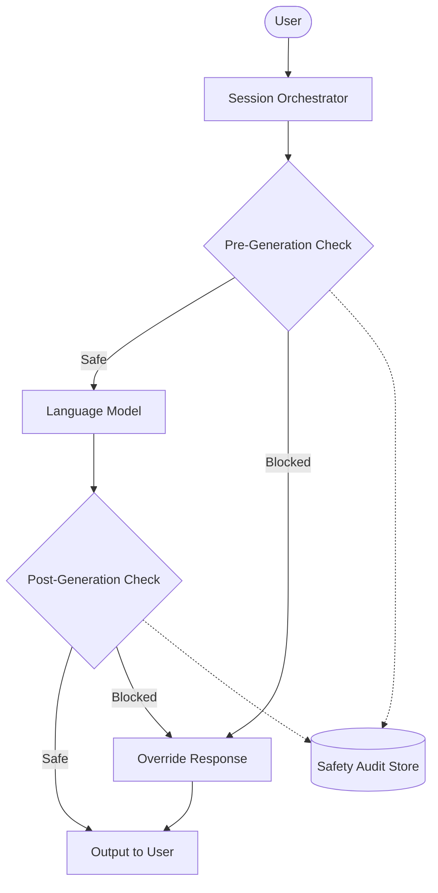

# Glow: Clinical Safety Plane

## Philosophy
Safety in Glow is treated as **code**, not as a prompt. Relying on an LLM to follow system prompts for critical safety guarantees (like refusing to diagnose or handling suicidal ideation) is prone to bypasses and failure modes. 

Therefore, Glow implements a **deterministic safety control plane** that sits *outside* the language model.

## Architecture

### 1. Pre-Generation Checks
Before a user message is sent to the LLM, it is evaluated by `run_pre_generation_check()`. This checks for:
- Underage usage (`is_adult_confirmed`).
- Prompt injection attempts.
- Overt crisis signals.

### 2. Post-Generation Checks
Before LLM output is surfaced to the user, `run_post_generation_check()` verifies that the model has not:
- Claimed to be a human therapist.
- Attempted to provide a medical diagnosis.
- Provided unverified crisis numbers.

### 3. Audit Trail
Every safety decision is logged to the `SafetyAuditEventModel`. This store is strictly separated from transcript retention. It contains structured risk assessments and actions taken, but strips raw therapy text to preserve privacy.
